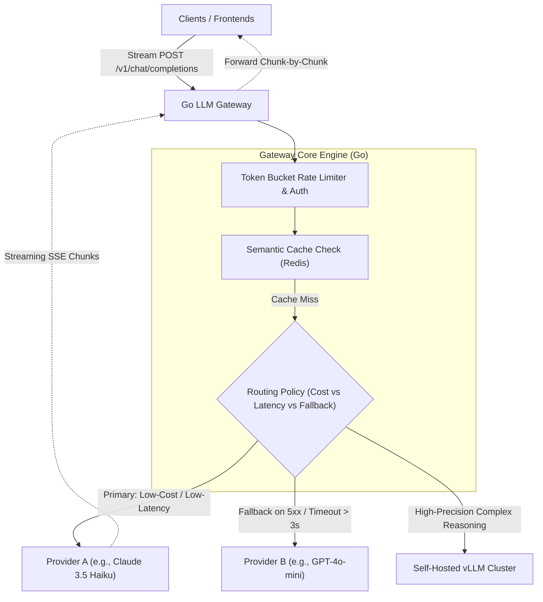

# High-Performance LLM Serving Gateway in Go

> **Category:** Modern AI Production Systems (2026 Standard) · **Priority:** 🏆 Tier 1 (Must-Have)
> 
> **Objective:** Design and implement a high-throughput, low-latency API reverse proxy in **Golang** for centralized LLM traffic, supporting multi-provider routing, dynamic failover, Server-Sent Events (SSE) token streaming, and token-bucket rate limiting.

---

## 1. The Production Problem

* Calling upstream LLM providers (OpenAI, Anthropic, or self-hosted vLLM) directly from individual microservices leads to:
  * Inconsistent retry, timeout, and fallback implementations.
  * Inability to centrally govern token consumption and enforce organization-wide budgets.
  * Total outage of downstream features when an upstream provider experiences regional degradation.

---

## 2. High-Level Architecture

---

## 3. Deep-Dive Mechanisms

1. **Zero-Buffer SSE Streaming**:
   * Uses Go goroutines, channels, and `http.Flusher` to stream response chunks downstream in real time without buffering entire payloads in memory, minimizing Time-to-First-Token (TTFT).
2. **Dynamic Failover & Circuit Breaking**:
   * If Provider A returns HTTP 429, 503, or latency exceeds a 3-second threshold, the gateway routes in-flight retries seamlessly to Provider B.
3. **Semantic Caching Integration**:
   * Checks semantic prompt similarity against Redis vector embeddings before invoking costly third-party APIs. If similarity > 0.92, cached completions are returned instantly at zero API cost.
