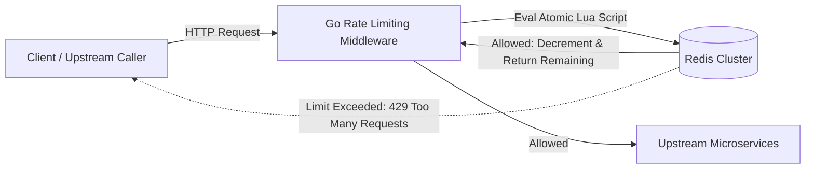

# Globally Distributed Rate Limiter in Go

> **Category:** Classical Distributed Systems · **Priority:** 🏆 Tier 1 (Must-Have)
> 
> **Objective:** Design and implement a high-throughput, low-latency distributed rate limiter in **Golang & Redis**, supporting Token Bucket and Sliding Window algorithms with atomic Lua scripts.

---

## 1. System Requirements

* **Functional Requirements:**
  * Rate limit requests per user ID, API key, or client IP.
  * Support bursty traffic configurations (e.g., sustained 100 req/min with burst allowance up to 120 reqs).
  * Return standard HTTP headers: `X-RateLimit-Limit`, `X-RateLimit-Remaining`, `X-RateLimit-Reset`, and `429 Too Many Requests` upon limit violation.
* **Non-Functional Requirements:**
  * Ultra-low latency overhead: Rate-limiting check must complete in **< 2ms** per request.
  * Distributed accuracy: Consistent enforcement across multiple horizontal Go app instances.
  * Resilience: Clear, configurable **Fail-Open vs. Fail-Closed** fallback strategy during Redis cluster outages.

---

## 2. Algorithm Comparison & Trade-offs

| Algorithm | Pros | Cons | Ideal Use Case |
| :--- | :--- | :--- | :--- |
| **Token Bucket** | Allows bursts of traffic; minimal memory footprint (stores only token count + last refill timestamp). | Requires atomic updates in distributed setups (Lua scripting). | General API Gateway protection. |
| **Sliding Window Counter** | Smooth boundary transitions; prevents the 2x traffic spike vulnerability at window edges. | Slight computational overhead compared to fixed windows. | Payment endpoints, authentication APIs. |
| **Sliding Window Log** | 100% precision down to the millisecond. | High memory footprint in Redis (stores timestamp entries per request in a Sorted Set). | Low-frequency, high-value operations (e.g., password reset, 5 attempts/day). |

---

## 3. High-Level Architecture



---

## 4. Failure Modes & Edge Cases

1. **Race Conditions in Distributed State**:
   * *Anti-Pattern:* Reading count with `GET`, calculating balance in Go, then saving with `SET`. Concurrent requests will overwrite each other.
   * *Solution:* Execute token balance checks and decrements inside a single **Redis Lua script**, ensuring ACID atomicity in 1 round-trip.
2. **Redis Outage / Network Partition**:
   * *Decision:* Fail-Open (allow traffic to maintain availability) or Fail-Closed (block requests to protect downstream DB)?
   * *Production Pattern:* Circuit breaker on Redis health; gracefully degrade to an in-memory token bucket per instance during Redis downtime.
3. **Bursty VIP Customers**:
   * *Follow-up:* Tiered configurations allowing dynamic capacity adjustments without code deployment.

---

## 5. Quickstart & Benchmark

```bash
# 1. Start Redis
docker compose up -d

# 2. Run Go Rate Limiter Service
go run cmd/server/main.go

# 3. Execute load test (measure p99 latency)
bash scripts/benchmark.sh
```
