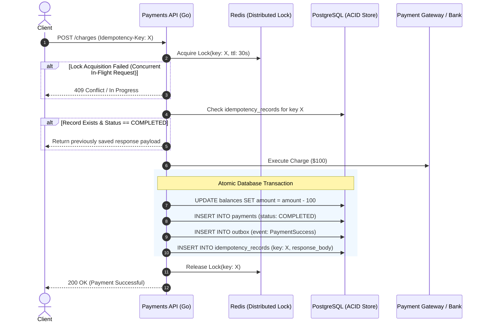

# Idempotent Payments API & Outbox Pattern in Go

> **Category:** Classical Distributed Systems · **Priority:** 🏆 Tier 1 (Must-Have FinTech)
> 
> **Objective:** Design and build an **Idempotent Payment Processing Engine** in Go, eliminating double-charging during network timeouts, client retries, and server crashes, utilizing distributed locking and the **Transactional Outbox Pattern**.

---

## 1. System Requirements

* **Functional Requirements:**
  * Clients send charge requests with an `Idempotency-Key: <UUID>` header.
  * Replayed requests with the same key within a 24-hour window must:
    * If still processing: Return `409 Conflict` or poll until complete.
    * If completed: Return the exact cached response from the initial transaction **without reprocessing or recharging**.
* **Non-Functional Requirements:**
  * Zero double-charging: Strong consistency (CP) over availability.
  * Crash Recovery: Safe reconciliation if the server crashes after charging third-party gateways (e.g., Stripe) but before committing to the internal ledger.

---

## 2. Solution Architecture (State Machine + Outbox)

---

## 3. Core Trade-offs & Production Mechanics

1. **Storage of Idempotency Records**:
   * *Trade-off:* Storing keys in Redis is fast, but eviction or failover can cause duplicate payments.
   * *Resolution:* Store idempotency keys in PostgreSQL within the same ACID transaction as the ledger. Redis is only used for temporary distributed mutual exclusion during execution.
2. **Transactional Outbox Pattern**:
   * Publishing directly to Kafka/RabbitMQ after DB commit introduces dual-write hazards (DB succeeds, broker publish fails).
   * *Resolution:* Insert event into the `outbox` table in the DB transaction. A dedicated background Go worker (or Debezium CDC) tails the outbox and publishes events with at-least-once delivery semantics.
3. **Third-Party Timeout Handling**:
   * If a Stripe call times out, the transaction status is marked `REQUIRES_RECONCILIATION`, handed off to an automated polling reconciler.
