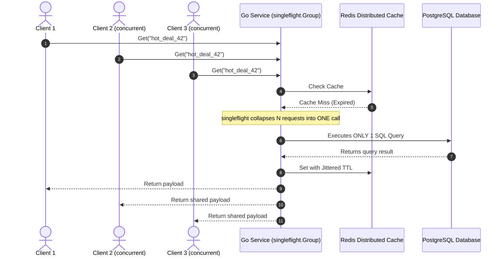

# Distributed Cache with SingleFlight in Go

> **Category:** Classical Distributed Systems · **Priority:** 🏆 Tier 1 (Must-Have)
> 
> **Objective:** Build a multi-tier distributed cache architecture (In-Memory LRU + Redis), completely eliminating the **Cache Stampede (Thundering Herd Problem)** under heavy concurrent traffic via `golang.org/x/sync/singleflight`.

---

## 1. Problem: The Cache Stampede (Thundering Herd)

* When a hot cache key (e.g., flash-sale product details with 20,000 requests/sec) expires:
  * Hundreds or thousands of concurrent requests observe a Cache Miss simultaneously.
  * All concurrent requests bypass the cache and query the database at the exact same instant.
  * Result: Database CPU reaches 100%, connection pools exhaust, and cascading system failure occurs.

---

## 2. Solution: The SingleFlight Deduplication Pattern

---

## 3. Engineering Mechanics

1. **`singleflight.Group`**:
   * Ensures that only one execution of a function is in-flight for a given key. Duplicate in-flight callers wait for the original call to complete and share the returned value.
2. **TTL Jitter**:
   * Appends randomized variance (e.g., `base_ttl + rand(0, 30s)`) to prevent simultaneous bulk expirations.
3. **Multi-Tier Invalidation**:
   * L1 In-Process LRU Cache for microsecond reads.
   * L2 Redis cluster for cross-node sharing.
   * Redis Pub/Sub invalidation bus to purge stale L1 entries across all nodes.
